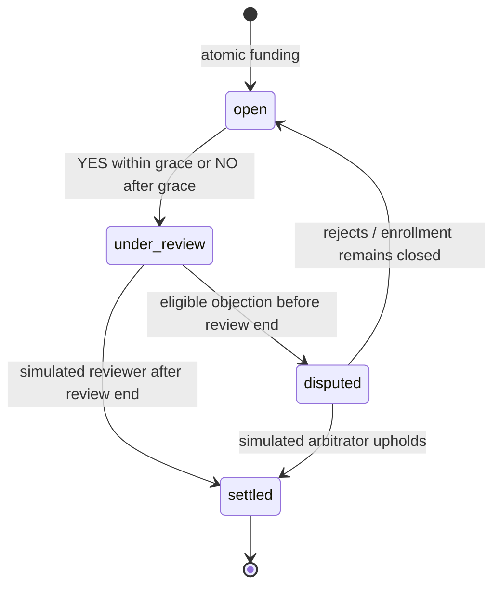

# Architecture

## State and commands

`src/domain/model.ts` defines Zod schemas and their inferred TypeScript types. The version-1 state has a shared numeric UTC demo clock, current identity, keyed users/wishes/proposals/participations, follow keys, a ledger, activity records, applied command IDs, and a global monotonic join sequence. Distribution is a discriminated union:

- `first`: per-person cents and slot count.
- `split`: total pool cents.
- `personal`: total amount and a designated recipient.

`src/domain/commands.ts` exposes `execute`. A command carries an externally generated idempotency ID and actor. The provider creates UUIDs outside the pure command layer. `execute` checks the actor and command guards, clones state, changes the clone, checks invariants, and returns the next state. Errors leave the caller’s state unchanged. A repeated command ID returns the unchanged state.

Commands: `commitWish`, `joinWish`, `toggleFollow`, `submitProposal`, `objectToProposal`, `finalizeProposal`, `arbitrateProposal`, `advanceClock`, and `switchUser`. `resetDemo` is the provider’s explicit confirmed replacement of the entire state using `createSeed`, rather than an ordinary monetary command. Terms have no edit or cancellation command.

The provider keeps an immediate state reference as well as React-rendered state, so consecutive event handlers operate on the latest accepted state. Form drafts stay local to the wizard. The React structure follows the [official guidance on avoiding duplicated and contradictory state](https://react.dev/learn/choosing-the-state-structure).

## Money

Input money strings are validated and split into dollar and cent strings before conversion. No fractional-dollar floating-point multiplication is used. Monetary values are integer cents and USD only.

The ledger contains balanced entries for `wallet:<user>`, `escrow:<wish>`, and `source`. Each person receives an explicit 100,000-cent opening credit against the negative fictional source account. The negative source balance intentionally offsets $3,000 in simulated opening credits.

Balances, gift totals, and escrow totals are derived. Funding debits the creator wallet and credits a wish’s escrow atomically. Joining, following, evidence, and disputes have no ledger entries. Settlement debits the entire escrow and credits recipients and/or creator refunds in one transaction.

`assertIntegrity` checks balanced transactions, nonnegative wallet/escrow balances during ledger replay, known accounts, opening-credit reconciliation, total conservation, exact wish funding, eligibility/order/slot rules, proposal consistency, and receipt/ledger reconciliation. Every ordinary state conserves 300,000 cents across wallets and escrow.

First-N allocation pays fixed gifts to enrolled recipients and refunds unfilled slots. Equal split uses integer division and distributes remaining cents in stable join-sequence order. Shares may be zero. Personal gifts pay only the designated person. Failure refunds all funds; successful public wishes with no recipients keep a successful outcome and refund all funds. Every settled wish has a receipt and zero escrow.

## Lifecycle and boundary choices

- Enrollment is open strictly before the deadline, until an earlier proposal freezes it.
- `closedAt` records the earlier of the deadline and first proposal time. Time advancement closes every affected wish; rejection never reopens enrollment.
- Event occurrence must be during the wish and no later than both the current clock and event deadline.
- YES is allowed through the inclusive 72-hour grace cutoff.
- NO is allowed strictly after that cutoff with no active proposal.
- Objections are accepted strictly before the review deadline. Finalization is allowed at or after it.
- Objections require the creator or an eligible recipient and are unique by person/proposal.
- Disputes hold funds until arbitration. Rejected proposals are archived, with a rationale, and new proposals obey the current evidence window. An existing review/dispute may finish after grace closes.
- Simulated reviewer/arbitrator controls are intentionally accessible to any of the three fictional demo people. They are demo roles, not a production authorization model.
- Settlement cannot repeat with a fresh command ID or a restored state. Follow/unfollow remains reversible after settlement because it does not affect money, eligibility, or outcome.

## Demo clock and seed

Operating-system time initializes the state once (rounded to the minute) and initializes a fresh seed on confirmed reset. Domain commands never use operating-system time. `advanceClock` only moves forward and affects every wish. The interface previews the resulting global time before confirmation.

The six stable seeded wishes are created and funded through the same command layer, chronologically. Historical joins, proposals, objections, and settlement run before the visible clock reaches first-launch time. The final seed clock is persisted. Reload does not rebase dates.

## Persistence and recovery

`kindred-demo-v1` stores the full state. Restore parses JSON, validates the complete schema, then checks relational and monetary invariants. Corrupt or incompatible saved data is retained until confirmed reset. The UI shows a recovery explanation and prevents ordinary mutations until reset; it renders an in-memory seed for recovery context.

Write failures show “Changes cannot be saved.” The in-memory session continues. localStorage is single-browser storage, not a secure ledger or shared backend. Multi-tab concurrent editing is unsupported. No distributed locking or synchronization is claimed.

## Rendering and sharing boundaries

React renders entered content as text. Source URLs must parse as HTTP(S). External links use `noopener noreferrer`; the app never fetches arbitrary evidence URLs or inserts entered HTML.

The native `dialog` provides modal focus containment. Opening captures the previous active element; Escape and closing return focus. Route changes focus the main content without scrolling away the navigation. Inputs have visible labels and inline errors; reduced-motion CSS suppresses motion.

Seeded detail links are portable and stable. Custom-wish sharing includes the readable promise and demo homepage, explicitly stating that local participation does not synchronize. Clipboard success is shown only after the write succeeds; errors retain selectable text. No social account posting or external repost verification occurs.

## Static hosting

Vite reads `BASE_PATH`, defaulting to `/`. Hash routing makes refreshes work without server rewrites. The Pages workflow derives a repository base path, allows an explicit Actions `BASE_PATH` variable for custom domains, and deploys only the default branch. No remote destination or live hosting configuration is assumed.
